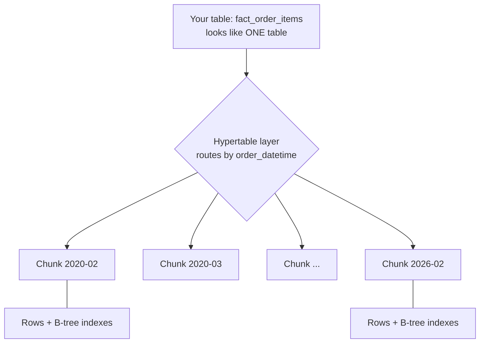
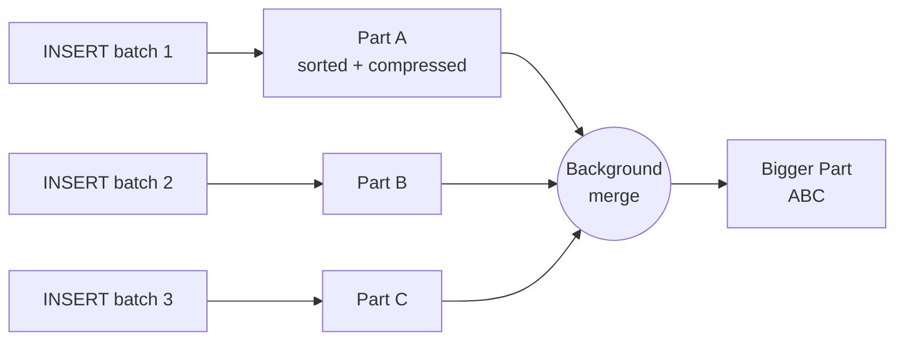
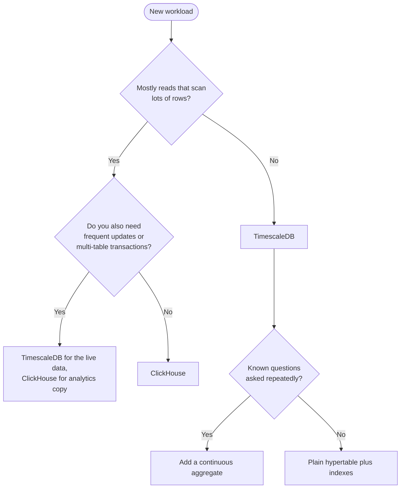
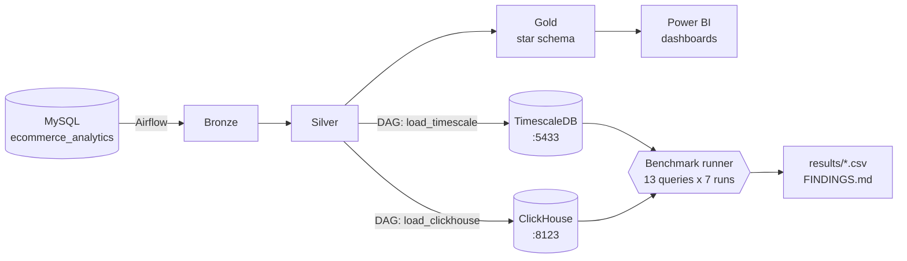
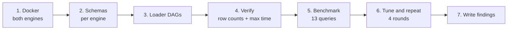

<div align="center">

# TimescaleDB vs ClickHouse

### Two databases, one dataset, thirteen questions, and a clear winner for each job


*An extension of the E-Commerce Medallion Data Warehouse (DM&BI case study)*

</div>

---

## Navigation

| # | Section | What you will learn |
|:-:|---|---|
| 0 | [The 60-second summary](#0-the-60-second-summary) | The whole story in one screen |
| 1 | [What is TimescaleDB?](#1-what-is-timescaledb) | PostgreSQL, specialised for time |
| 2 | [What is ClickHouse?](#2-what-is-clickhouse) | A database built only for analytics |
| 3 | [How TimescaleDB works inside](#3-how-timescaledb-works-inside) | Hypertables, chunks, columnstore, continuous aggregates |
| 4 | [How ClickHouse works inside](#4-how-clickhouse-works-inside) | Columns, parts, sparse index, merges |
| 5 | [Theoretical comparison](#5-theoretical-comparison) | Side by side, feature by feature |
| 6 | [Which database for which query](#6-which-database-for-which-query) | Example queries with a verdict for each |
| 7 | [Our project: the big picture](#7-our-project-the-big-picture) | Where the benchmark fits in the warehouse |
| 8 | [What we built, step by step](#8-what-we-built-step-by-step) | Schemas, loader DAGs, benchmark runner |
| 9 | [Findings](#9-findings) | Load time, storage, all 13 queries, 4 tuning rounds |
| 10 | [Problems we hit and how we fixed them](#10-problems-we-hit-and-how-we-fixed-them) | The honest part |
| 11 | [Conclusion](#11-conclusion) | What to use, when |
| 12 | [Limitations and how to reproduce](#12-limitations-and-how-to-reproduce) | What we did not test, how to rerun |

> [!TIP]
> New to both databases? Read sections 1 to 6 in order. Short on time? Read section 0, then jump to section 9.

---

## 0. The 60-second summary

```text
        THE QUESTION                                  THE ANSWER
 ┌──────────────────────────────┐        ┌────────────────────────────────────────────┐
 │ We have 1.3M order lines and │        │  ClickHouse wins 12 of 13 analytical       │
 │ 6M cart lines. Which engine  │  ───►  │  queries, usually by 10x or more, and      │
 │ answers dashboard questions  │        │  stores the data in about a third of the   │
 │ faster, and where does each  │        │  space. TimescaleDB ties on one-row lookups│
 │ one shine?                   │        │  and matches ClickHouse on pre-computed    │
 └──────────────────────────────┘        │  summaries.                                │
                                         └────────────────────────────────────────────┘
```

| | TimescaleDB | ClickHouse |
|---|:-:|:-:|
| Analytical queries won (out of 13) | 0 | **12** |
| Ties | 1 (single order lookup) | 1 (same query) |
| Data size on disk (order lines) | 252 MB, or 81 MB with columnstore | **74 MiB** |
| Load time for all 5 tables | 65.7 s | 67.8 s |
| Keeps transactions, updates, ordinary SQL joins | **Yes** | Limited |
| Best at | Mixed workloads on time series | Fast analytics on huge tables |

---

## 1. What is TimescaleDB?

**TimescaleDB is PostgreSQL with superpowers for time-based data.** It is not a separate database. It is an *extension* you switch on inside PostgreSQL.

```text
┌─────────────────────────────────────────────┐
│                 PostgreSQL                  │
│  tables, indexes, transactions, SQL, JOINs  │
│  ┌───────────────────────────────────────┐  │
│  │          TimescaleDB extension        │  │
│  │  hypertables · chunks · columnstore   │  │
│  │  continuous aggregates · time_bucket  │  │
│  └───────────────────────────────────────┘  │
└─────────────────────────────────────────────┘
```

**The idea in one sentence:** you keep everything you already know about PostgreSQL, and the extension makes tables that grow along a time axis (orders, sensor readings, logs, prices) faster to write, query and store.

| You get | Meaning |
|---|---|
| Full PostgreSQL | Every tool, driver and SQL feature that works with Postgres also works here |
| Transactions (ACID) | Inserts, updates and deletes are safe and consistent |
| Hypertables | A table that automatically splits itself into time-based pieces |
| Columnstore | Old data is converted to a compact, column-oriented layout |
| Continuous aggregates | Self-updating summary tables (a "materialized view that stays fresh") |

**Mental model:** *a very good filing cabinet that already has a smart drawer for each month.*

---

## 2. What is ClickHouse?

**ClickHouse is a database built from scratch for one job: answering analytical questions over huge tables, fast.** It is an open-source, column-oriented OLAP (Online Analytical Processing) database management system.

```text
   Question: "What was total revenue per channel?"

   Row database reads:         ClickHouse reads:
   ┌────┬─────┬───────┬─────┐   ┌────┐ ┌─────┐ ┌───────┐ ┌─────┐
   │ id │ qty │ price │ ch. │   │ id │ │ qty │ │ price │ │ ch. │
   ├────┼─────┼───────┼─────┤   └────┘ └─────┘ └───┬───┘ └──┬──┘
   │ 1  │  2  │  250  │ web │                      │        │
   │ 2  │  1  │  900  │ app │   only these two columns are read
   │ …  │  …  │   …   │  …  │   the rest never leave the disk
   └────┴─────┴───────┴─────┘
   reads EVERY column of EVERY row
```

**The idea in one sentence:** store each column on its own, compress it hard, and process it with all CPU cores at once.

| You get | Meaning |
|---|---|
| Column storage | A query touches only the columns it names |
| Heavy compression | Similar values sit together, so they shrink a lot |
| Parallel, vectorised execution | Many cores process blocks of values at once |
| MergeTree tables | The core table engine: sorted, partitioned, append-friendly |
| Materialized views | Summaries that update automatically as data arrives |
| Own SQL dialect | Mostly familiar SQL, plus many analytical functions |

**Mental model:** *a warehouse where every product type has its own aisle, so counting one type never means walking past the others.*

---

## 3. How TimescaleDB works inside

### 3.1 Hypertables and chunks

You create a normal table, then turn it into a **hypertable**. TimescaleDB then splits it into **chunks**, one per time range. In our project: **one chunk per month**, 73 chunks in total.



**Why this helps:**
- **Chunk exclusion.** A query for "last 7 days" only opens the newest chunk and skips the other 72.
- **Cheap maintenance.** Dropping old data means dropping a whole chunk, not deleting millions of rows.
- **Smaller indexes.** Each chunk's index is small and fits in memory.

### 3.2 Row store first, columnstore later

New data lands in the classic PostgreSQL **row layout**. That is what makes inserts, updates and one-row lookups fast. Once data is old, a policy or command converts a chunk to the **columnstore**:

```text
   Row layout (hot, recent)                 Columnstore (cold, old)
   ┌──────────────────────────┐             ┌────────────────────────────┐
   │ row1: id, qty, price, ch │             │ channel = web                │
   │ row2: id, qty, price, ch │   convert   │   qty:   [2,1,2,3,…] packed │
   │ row3: id, qty, price, ch │  ────────►  │   price: [250,900,…] packed │
   │ …                        │             │ channel = app                │
   └──────────────────────────┘             │   qty:   […] packed         │
                                            └────────────────────────────┘
        segmentby = channel   (one group per value)
        orderby   = order_datetime DESC (sorted inside each group)
```

`segmentby` and `orderby` are the two knobs you choose. Choosing them well is the difference between a big speed-up and a slowdown (we saw both, see [section 9.5](#95-tuning-rounds-on-timescaledb)).

### 3.3 Continuous aggregates

A **continuous aggregate** is a summary table the database keeps up to date for you.

```sql
CREATE MATERIALIZED VIEW daily_channel_revenue
WITH (timescaledb.continuous) AS
SELECT time_bucket('1 day', order_datetime) AS day,
       channel,
       SUM(line_total) AS net_revenue
FROM   fact_order_items
GROUP  BY 1, 2;
```

Dashboards then read ~7,000 pre-added rows instead of 1.3 million raw ones.

### 3.4 What runs the query

The **standard PostgreSQL executor**. That is its strength (every SQL feature works) and its limit (a query like `COUNT(DISTINCT ...)` cannot be split across cores, see [section 9.4](#94-all-13-queries)).

---

## 4. How ClickHouse works inside

### 4.1 Parts: write once, merge later

Every `INSERT` creates a new, immutable **part** on disk. A background process merges small parts into bigger ones (the "Merge" in MergeTree).



> [!IMPORTANT]
> Because every insert makes a part, ClickHouse wants **big batches** (our loader sends 200,000 rows at a time), not one row per insert.

### 4.2 Inside one part: columns, sorted, with a sparse index

```text
   Part folder on disk
   ├── order_datetime.bin   ← one file per column, compressed
   ├── channel.bin
   ├── line_total.bin
   ├── ...
   └── primary.idx          ← sparse index: ONE entry per ~8,192 rows (a "granule")
```

Data inside a part is **sorted by the `ORDER BY` key** (ours: `time, id`). The index does not list every row. It lists the first key of every granule, so it stays tiny and sits in memory. A query uses it to skip all granules that cannot match.

### 4.3 How a query runs


### 4.4 Design trade-offs you accept

| ClickHouse gives you | In exchange for |
|---|---|
| Very fast scans and aggregations | `UPDATE` and `DELETE` are heavy background rewrites, not instant row edits |
| Huge compression | No full multi-statement transactions like PostgreSQL |
| Simple, fast ingest of big batches | Many tiny inserts are a bad fit |
| Tiny sparse index | Single-row lookups are good but not B-tree-instant by design |

---

## 5. Theoretical comparison

### 5.1 Side by side

| Aspect | TimescaleDB | ClickHouse |
|---|---|---|
| **Type** | Extension of PostgreSQL (OLTP + time-series analytics) | Purpose-built columnar OLAP database |
| **Storage layout** | Rows by default, columnstore for older chunks | Columns always |
| **Partitioning** | Automatic time chunks (hypertable) | You choose `PARTITION BY` (we used month) |
| **Index** | B-tree and other PostgreSQL indexes | Sparse primary index plus optional skipping indexes |
| **Query execution** | PostgreSQL executor, limited parallelism | Vectorised, parallel across cores |
| **Transactions** | Full ACID | Not like PostgreSQL |
| **Updates and deletes** | Normal and fast | Heavy, designed to be rare |
| **Inserts** | Single rows or batches both fine | Large batches strongly preferred |
| **Joins** | Full PostgreSQL join power | Works, but wide joins are not its strength |
| **SQL** | Standard PostgreSQL SQL | Own dialect, very rich in analytical functions |
| **Ecosystem** | Every PostgreSQL tool, ORM and driver | Own clients and integrations |
| **Pre-computed summaries** | Continuous aggregates | Materialized views |
| **Typical size of the same data** | Larger (smaller with columnstore) | Smaller |

### 5.2 One picture: where each one is strong

```text
                     few rows touched ◄──────────────► billions of rows touched
                   ┌───────────────────────────────────────────────────────────┐
 write-heavy,      │  TimescaleDB zone                                         │
 updates, ACID     │  point lookups, small writes,                             │
                   │  mixed app + analytics                                    │
                   ├───────────────────────────────┬───────────────────────────┤
 read-heavy,       │       overlap: both fine      │   ClickHouse zone         │
 append-only       │       (small data,            │   big scans, group-bys,   │
 analytics         │        pre-computed summaries)│   dashboards, logs        │
                   └───────────────────────────────┴───────────────────────────┘
```

---

## 6. Which database for which query

The same business questions, with the verdict. The SQL differs slightly between engines but the *shape* of the work is what matters.

### 6.1 Query shape cheat sheet

| Query shape | Example question | Better fit | Why |
|---|---|---|---|
| **Wide scan + aggregate** | Total revenue per channel over all history | ClickHouse | Reads two columns only, parallel |
| **Time bucket trend** | Revenue per month for 6 years | ClickHouse | Partition pruning plus fast aggregation |
| **COUNT(DISTINCT)** | Active customers per month | ClickHouse | Postgres cannot parallelise it |
| **High-cardinality GROUP BY** | Top 100 customers by revenue | ClickHouse | Efficient hash aggregation |
| **Join to a small dimension** | Top 10 products with names | Both fine | Small join, gap narrows |
| **Point lookup** | Show order #123456 | **Tie** (TimescaleDB with an index) | B-tree is built for this |
| **Update one row** | Mark an order as RETURNED | **TimescaleDB** | ClickHouse updates are heavy |
| **Transaction across tables** | Insert order + payment atomically | **TimescaleDB** | Full ACID |
| **Known dashboard KPI** | Daily revenue by channel | Tie, with a pre-computed summary | Both read a tiny table |
| **Streaming of tiny inserts** | One row at a time from an app | **TimescaleDB** | ClickHouse prefers batches |

### 6.2 Example queries

**A. Big aggregation — ClickHouse territory**

```sql
-- Revenue by channel across 1.3M order lines
SELECT channel, SUM(line_total) AS revenue
FROM   fact_order_items
WHERE  order_status NOT IN ('CANCELLED', 'RETURNED')
GROUP  BY channel;
```
> Measured here: TimescaleDB about 0.9 to 1.0 s, ClickHouse about 27 ms.

**B. Distinct counting — ClickHouse territory**

```sql
-- How many different customers bought each month?
SELECT date_trunc('month', order_datetime) AS month,
       COUNT(DISTINCT customer_id)         AS active_customers
FROM   fact_order_items
GROUP  BY 1;
```
> PostgreSQL cannot parallelise `COUNT(DISTINCT ...)`. ClickHouse spreads the work over all cores.

**C. Point lookup — a tie, with the right index**

```sql
SELECT * FROM fact_order_items WHERE order_id = 987654;
```
> TimescaleDB 3.2 ms with an index on `order_id`, ClickHouse 2.9 ms. Without the index TimescaleDB took 21.5 ms.

**D. Update — TimescaleDB territory**

```sql
UPDATE fact_order_items
SET    order_status = 'RETURNED'
WHERE  order_id = 987654;
```
> Instant in PostgreSQL/TimescaleDB. In ClickHouse this is a *mutation* that rewrites data parts in the background. Not what the engine is for.

**E. Summary table — both engines become equal**

```sql
SELECT day, channel, net_revenue
FROM   daily_channel_revenue;      -- ~7,300 rows instead of 1.3 million
```
> TimescaleDB 7 ms, ClickHouse 11 ms, a tie for practical purposes.

### 6.3 Decision flowchart



---

## 7. Our project: the big picture

The base project is an **E-Commerce Medallion Data Warehouse**. A MySQL source system feeds a PostgreSQL warehouse through Apache Airflow, in three layers:

| Layer | Role | Analogy |
|---|---|---|
| **Bronze** | Raw copy of the source, nothing removed | Delivery truck unloading |
| **Silver** | Cleaned, typed, deduplicated | Sorted shelves |
| **Gold** | Business-ready star schema for BI | Shop window |

**The extension:** take the clean **Silver** layer and load the same data into **both** TimescaleDB and ClickHouse with two separate Airflow DAGs, then time the same analytical queries on each.



**Dataset in numbers**

| Table | Rows | Type |
|---|--:|---|
| `fact_cart_items` | 5,963,986 | Fact (hypertable in TimescaleDB) |
| `fact_order_items` | 1,310,429 | Fact (hypertable in TimescaleDB) |
| `fact_payments` | 439,248 | Fact |
| `dim_customer` | 200,000 | Dimension |
| `dim_product` | 319 | Dimension |

About **6 years** of orders (Feb 2020 to Feb 2026), which becomes **73 monthly chunks and partitions**.

---

## 8. What we built, step by step



| Step | What we did | Where it lives |
|:-:|---|---|
| 1 | Started TimescaleDB (port 5433) and ClickHouse (8123) in Docker | `docker-compose.yml` |
| 2 | Wrote a schema for each engine. TimescaleDB: hypertables with 1-month chunks. ClickHouse: MergeTree, `PARTITION BY` month, `ORDER BY (time, id)`, `LowCardinality(String)` for repeated text | `sql-scripts/01_...`, `02_...` |
| 3 | Wrote two Airflow DAGs. TimescaleDB loads with `COPY`. ClickHouse loads in 200,000-row batches over HTTP | `dags/db-test/load_timescale.py`, `load_clickhouse.py` |
| 4 | Each DAG ends with a `verify` task: row counts must equal Silver, and `max(timestamp)` must match | inside the DAGs |
| 5 | Wrote 13 analytical queries in both SQL dialects. The runner executes each 7 times, keeps the first run and the median of the other six ("warm"), and **hashes the result rows** so we know both engines return the *same answer* | `analytical_queries.py`, `run_query_benchmark.py` |
| 6 | Tuned TimescaleDB one change at a time and re-ran: index, memory, columnstore, summaries | `sql-scripts/03_...` to `06_...` |
| 7 | Saved every round as its own CSV and wrote the conclusions | `results/`, `FINDINGS.md` |

> [!NOTE]
> **Fairness rule:** a fast wrong answer does not count. Every number below comes with a `MATCH` check, and all 13 queries match across both engines.

---

## 9. Findings

### 9.1 Loading the data

| Table | Rows | TimescaleDB | ClickHouse |
|---|--:|--:|--:|
| dim_customer | 200,000 | 0.68 s | 0.94 s |
| dim_product | 319 | 0.00 s | 0.07 s |
| fact_payments | 439,248 | 0.72 s | 1.60 s |
| fact_order_items | 1,310,429 | 7.38 s | 12.24 s |
| fact_cart_items | 5,963,986 | 56.90 s | 52.97 s |
| **Total** | | **65.7 s** | **67.8 s** |

> [!NOTE]
> **A tie.** Both loaders spend almost all their time *reading Silver out of PostgreSQL*, not writing. Load speed does not separate the engines here.

### 9.2 Storage on disk

```text
 fact_order_items (1.3M rows)                    fact_cart_items (6.0M rows)

 TimescaleDB rows   ████████████████████ 252 MB   TimescaleDB rows   ████████████████████ 940 MB
 TS columnstore     ██████░░░░░░░░░░░░░░  81 MB   TS columnstore     ████████░░░░░░░░░░░░ 354 MB
 ClickHouse         ██████░░░░░░░░░░░░░░  74 MiB  ClickHouse         ██████░░░░░░░░░░░░░░ 277 MiB
```

| Table | TimescaleDB rows | TimescaleDB columnstore | ClickHouse |
|---|--:|--:|--:|
| fact_order_items | 252 MB | 81 MB | 74 MiB |
| fact_cart_items | 940 MB | 354 MB | 277 MiB |
| fact_payments | 38 MB | not converted | 13.7 MiB |
| dim_customer | 38 MB | not converted | 17.8 MiB |

ClickHouse stores the data in **about one third** of the plain PostgreSQL space. Columnstore closes most of the gap (orders within about 10%, carts about 28% larger).

### 9.3 How we measured

| Setting | Value |
|---|---|
| Runs per query | 7 |
| "First" | Run 1 (cold-ish) |
| "Warm" | Median of runs 2 to 7 |
| Same answer check | MD5 fingerprint of normalised result rows |
| Run-to-run noise | About 1 to 4% (a full repeat of round 3) |
| Ignore | Differences under ~10 ms: that is connection overhead (HTTP vs native protocol) |

### 9.4 All 13 queries

TimescaleDB column is the **fastest of three setups** (no tuning, `order_id` index, columnstore), which is the best case for TimescaleDB. ClickHouse is **untuned**.

| Query | Question | Type | TimescaleDB (best) | ClickHouse | ClickHouse faster | Winner |
|:-:|---|---|--:|--:|:-:|:-:|
| Q01 | Revenue by channel | scan + group | 926 ms | 27 ms | **34x** | 🟡 ClickHouse |
| Q02 | Monthly revenue trend | time bucket | 255 ms | 26 ms | **10x** | 🟡 ClickHouse |
| Q03 | Top 10 products | small join | 61 ms | 26 ms | **2x** | 🟡 ClickHouse |
| Q04 | Category revenue by month | join + time | 247 ms | 42 ms | **6x** | 🟡 ClickHouse |
| Q05 | Cart funnel by channel | scan, 6M rows | 4.95 s | 96 ms | **51x** | 🟡 ClickHouse |
| Q06 | Abandoned cart value by month | scan + time | 4.73 s | 83 ms | **57x** | 🟡 ClickHouse |
| Q07 | Payment status by method | small scan | 36 ms | 5.7 ms | **6x** | 🟡 ClickHouse |
| Q08 | Active customers per month | COUNT DISTINCT | 170 ms | 16 ms | **11x** | 🟡 ClickHouse |
| Q09 | Top 100 customers | high-cardinality | 509 ms | 29 ms | **18x** | 🟡 ClickHouse |
| Q10 | One order by id | point lookup | 3.2 ms | 2.9 ms | about equal | 🤝 Tie |
| Q11 | Last 7 days by channel | recent range | 75 ms | 7.6 ms | **10x** | 🟡 ClickHouse |
| Q12 | Daily revenue rollup | daily bucket | 230 ms | 21 ms | **11x** | 🟡 ClickHouse |
| Q13 | Cart lines by status | full scan | 214 ms | 22 ms | **10x** | 🟡 ClickHouse |

**The gap, drawn** (each block is about 2x):

```text
 Q06 cart value by month  ██████████████████████████████ 57x
 Q05 cart funnel          ██████████████████████████     51x
 Q01 revenue by channel   █████████████████              34x
 Q09 top customers        █████████                      18x
 Q08 distinct customers   ██████                         11x
 Q12 daily rollup         ██████                         11x
 Q13 cart status          █████                          10x
 Q11 last 7 days          █████                          10x
 Q02 monthly trend        █████                          10x
 Q07 payment methods      ███                             6x
 Q04 category by month    ███                             6x
 Q03 top products         █                               2x
 Q10 one order by id      ▏                          about equal
```

**What the pattern says**
- The more rows a query touches, the bigger the gap (Q05 and Q06 read 6 million rows: 51x to 57x).
- Even the small-table queries still favour ClickHouse, but the gap shrinks.
- The only tie is the one query PostgreSQL was designed for: *fetch one row through an index*.
- **Distinct counting:** the plan we inspected for Q02 was a serial aggregate over 73 per-chunk sorts. PostgreSQL cannot parallelise `COUNT(DISTINCT ...)`, so this is a limit of the executor, not a tuning mistake.

### 9.5 Tuning rounds on TimescaleDB

We gave TimescaleDB every fair chance, changing **one thing per round**:

| Round | Change | What happened |
|:-:|---|---|
| **1** | Nothing (baseline) | ClickHouse faster on all 13 (2.6x to 64.7x) |
| **2** | Index on `order_id` | Q10 fell from 21.5 ms to **3.2 ms** (about 7x). Everything else only 3 to 11% faster |
| **2b** | Index plus `work_mem` = 256 MB | ❌ **Rejected.** Q02, Q04, Q08, Q12 became **2 to 3x slower**. Settings reverted |
| **3** | Columnstore compression | 🟢 Storage down by 60 to 70%, big scans 5 to 15% faster. 🔴 Q02, Q08, Q12 became **2 to 3x slower**, Q10 rose to 12.8 ms |
| **4** | Pre-computed daily summary | 🟢 Closes the gap for the questions the summary covers (next section) |

> [!WARNING]
> **Tuning is a trade-off, not a free win.** Two of our four tuning attempts made some queries *worse*. We do not know the exact reason for the `work_mem` slowdown; we have a hypothesis but did not confirm it, so it is not stated as fact.

### 9.6 Round 4: pre-computed summaries

Both engines can keep a small daily summary table (`daily_channel_revenue`, about 7,300 rows). TimescaleDB uses a continuous aggregate, ClickHouse a materialized view.

| Query | Reads | TimescaleDB | ClickHouse | Speed-up from summary |
|---|---|--:|--:|---|
| Q14 daily revenue by channel | raw table | 271 ms | 37 ms | |
| Q14s same question | **summary** | **7.2 ms** | 10.9 ms | TimescaleDB 38x, ClickHouse 3x |
| Q15 monthly revenue and units | raw table | 253 ms | 16 ms | |
| Q15s same question | **summary** | **1.9 ms** | **1.9 ms** | TimescaleDB 133x, ClickHouse 8x |

- Summary results are **identical** to raw-table results (same rows, checked), and the revenue totals agree: 9,646,472,767.95.
- With a summary the engines are **level** for the questions you know in advance.
- The catch: a summary only answers questions at *its own grain* (day and channel). A brand-new question goes back to the raw table, where ClickHouse wins again.

### 9.7 Scoreboard

```text
                     ┌────────────────────────────────────────────┐
   13 analytical     │  ClickHouse   ████████████  12 wins        │
   queries           │  Tie          █              1             │
                     │  TimescaleDB                 0 wins        │
                     └────────────────────────────────────────────┘
```

---

## 10. Problems we hit and how we fixed them

Honest failures teach more than clean results.

<details>
<summary><b>🕐 The 5 hours 30 minutes timestamp bug</b> (click to expand)</summary>

**Symptom:** five queries (Q02, Q04, Q06, Q08, Q12) returned *different answers* in the two engines.

**Cause:** the ClickHouse Python client converts a "naive" timestamp using the **computer's local time zone** (India, UTC+5:30). Every stored time shifted back by 5h30m, so some rows moved to the previous day or month, which broke day and month grouping.

**How we found it:** Silver's latest order was `23:59:57`, ClickHouse's was `18:29:57`.

**Fix:** tag every timestamp as UTC before inserting, and add a check to the loader that compares `max(timestamp)` between Silver and ClickHouse so this fails loudly in future. After the fix all 13 queries `MATCH`.

**Lesson:** compare row counts *and* a value check. Counts alone would never have caught this.
</details>

<details>
<summary><b>🐢 Why work_mem made things slower</b></summary>

Raising `work_mem` to 256 MB was meant to stop sorts spilling to disk. Instead Q02, Q04, Q08, Q12 got 2 to 3x slower. The `index_only` run proved the index was not the cause. We rejected the change and reset it. **We did not confirm the mechanism**, so we only report the measurement.
</details>

<details>
<summary><b>🧹 A reload wipes the tuning</b></summary>

The loader DAGs drop and recreate the tables, which deletes the index, the columnstore, the continuous aggregate and the ClickHouse materialized view. After any reload, rerun scripts `03`, `04`, `06` (TimescaleDB) and `05` (ClickHouse). This is documented in the README.
</details>

<details>
<summary><b>🧭 Airflow UI showed 0 DAGs</b></summary>

The DAGs ran correctly from the command line but did not appear in the web UI at first. Resolved later; we used the command line in the meantime so the work was never blocked.
</details>

---

## 11. Conclusion

### The decision table

| If your workload is... | Choose |
|---|---|
| Dashboards and reports over millions of rows | **ClickHouse** |
| `COUNT(DISTINCT)`, big `GROUP BY`, wide scans | **ClickHouse** |
| Smallest storage bill | **ClickHouse** |
| Looking up and updating individual records | **TimescaleDB** |
| Transactions across tables, existing PostgreSQL ecosystem | **TimescaleDB** |
| A fixed set of dashboard KPIs | **Either**, with a summary table |
| A live application *and* analytics | **TimescaleDB for the app, ClickHouse as an analytics copy** |

### Four takeaways

1. 🏁 **For analytics on this data, ClickHouse is the clear winner:** faster on 12 of 13 queries, usually by 10x or more, with no tuning, in about a third of the space.
2. 🎯 **TimescaleDB is not "worse", it is different.** It keeps PostgreSQL's strengths: transactions, updates, point lookups, familiar tooling.
3. ⚖️ **Tuning is a trade-off.** Index, memory and columnstore each helped some queries and hurt others. Always measure per workload.
4. 🤝 **They can work together.** Keep the system of record in a transactional database, stream analytics to ClickHouse. Our Medallion warehouse already follows that "operational source to analytical store" idea.

---

## 12. Limitations and how to reproduce

### What we did **not** test

- One machine, one dataset of about 1.3 million order lines (larger data usually widens the gap, untested).
- One user at a time: **no concurrency** test.
- **No cold-start** (empty cache) test and no write-while-reading test.
- ClickHouse was run untuned (it did not need tuning for these queries).
- TimescaleDB's "best of 3 rounds" column picks the best setup *per query*. No single setup achieves all of them at once, so it is an upper bound.
- The claim that a TimescaleDB continuous aggregate generally cannot hold `COUNT(DISTINCT)` comes from documentation knowledge, not from our test.
- Differences under about 10 ms are not reliable for ranking.

### Repository map

```text
db-benchmark/
├── docker-compose.yml                    two containers
├── sql-scripts/
│   ├── 01_timescale_schema.sql
│   ├── 02_clickhouse_schema.sql
│   ├── 03_timescaledb_order_id_index.sql
│   ├── 04_timescaledb_columnstore.sql
│   ├── 05_clickhouse_materialized_view.sql
│   └── 06_timescaledb_continuous_aggregate.sql
├── analytical_queries.py                 the 13 queries, two dialects
├── precomputed_summary_queries.py        round 4
├── run_query_benchmark.py                timing + same-answer check
├── run_summary_benchmark.py              round 4 runner
├── results/                              one CSV per round + load logs
├── FINDINGS.md                           short version
└── README.md                             setup and run order
```

### Reproduce in 3 commands

```bash
docker compose -f db-benchmark/docker-compose.yml up -d     # 1. start both engines
airflow dags test load_timescale && airflow dags test load_clickhouse   # 2. load
python db-benchmark/run_query_benchmark.py my_run           # 3. benchmark
```

Full setup (database creation, Airflow connections, tuning scripts and the reload order) is in `db-benchmark/README.md`.

---

<div align="center">

**TimescaleDB vs ClickHouse** · E-Commerce Medallion Data Warehouse · DM&BI Case Study

*Every number in this document comes from our own runs. The raw timings are in `db-benchmark/results/`.*

</div>
